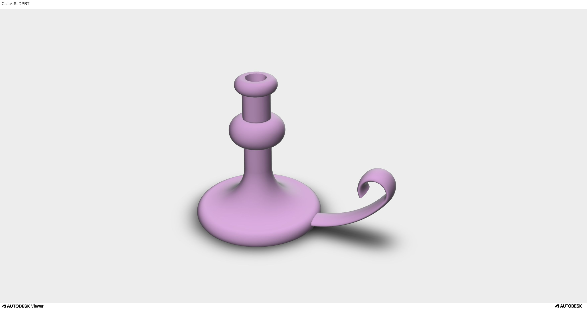

# SolidWorks Candlestick Holder

## Overview

This project features a 3D candlestick holder modeled in SolidWorks as a CAD modeling exercise.

The design includes a rounded base, a central cylindrical section, and a curved side handle.

## Preview

## Design Features

- Rounded base and smooth transitions between surfaces
- Cylindrical upper section
- Curved decorative handle
- Smooth, rounded geometry

## Tools

- **CAD software:** SolidWorks
- **Project type:** 3D modeling

## Project Files

- `images/` — rendered preview of the model
- `models/` — original CAD files, if available
- `docs/` — supporting documentation, if available

## Context

This project is part of my collection of university CAD modeling exercises.
